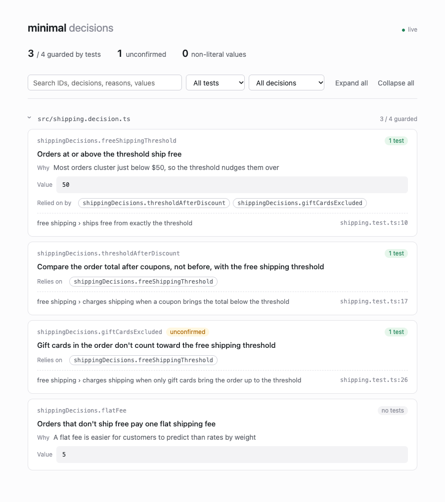

<h1 align="center">
  <picture>
    <source media="(prefers-color-scheme: dark)" srcset="docs/logo-dark.png">
    
  </picture>
</h1>

<p align="center"><strong>Remember why your code exists.</strong></p>

<p align="center">English · <a href="README.ko.md">한국어</a></p>

Akashiq is a decision tracing tool that remembers why your code is the way it is. It records the decisions behind your code, with their reasons, as typed objects in TypeScript, and links each one to the tests that prove it. A dashboard shows what was decided, why, and whether a test still guards it. An agent skill teaches coding agents to work the same way.

The name comes from the Akashic Records, a mythical record of everything that has ever happened. The Q is for Query.



## Why

When code is written with AI agents, the code that works survives and the intent behind it evaporates. Spec documents grow faster than anyone can read them, comments scatter and go stale, and a new requirement quietly overrides an old policy that nobody remembered.

Akashiq doesn't try to remember everything. It remembers the reasons you can't afford to forget:

- **Decisions live in code.** A threshold, a policy, or an exception that the code alone can't explain is declared once, with its reason, and the code reads its value from there.
- **Tests prove decisions.** A test that guards a decision says so with `guards(decision, …)`. Rename or delete the decision and the type check fails.
- **History stays in Git.** A decision holds only the current conclusion. How it got there is in the commit messages.

This is requirements traceability, applied to AI-driven development and kept inside the code where agents actually look.

## Install

```bash
npm install --save-dev akashiq @akashiq/core
```

`@akashiq/core` holds the `Decision` types and `guards`, and has no dependencies. `akashiq` holds the dashboard, the CLI, and the agent skill, and needs Node.js 22 or later. Both can be dev dependencies: decision files import only types, and `guards` is used only in tests.

## Usage

### 1. Record a decision

Put decisions in a `*.decision.ts` file next to the code they concern. Akashiq finds these files anywhere in the project.

```ts
// src/shipping.decision.ts
import type { AnyDecision, Decision } from "@akashiq/core";

export const shippingDecisions = {
  freeShippingThreshold: {
    decision: "Orders at or above the threshold ship free",
    value: 50,
    reason: "Most orders cluster just below $50, so the threshold nudges them over",
  } satisfies Decision<number>,
  thresholdAfterDiscount: {
    decision: "Compare the order total after coupons, not before, with the free shipping threshold",
    dependsOn: (): AnyDecision[] => [shippingDecisions.freeShippingThreshold],
  } satisfies Decision,
};
```

| Field | |
|---|---|
| `decision` | What was decided, in one or two sentences. |
| `value` | The value code reads, if any. Declare the decision as `Decision<T>` to require it, or `Decision` to forbid it. Write it as a literal. |
| `reason` | Why, as the person who decided it said. Leave it out rather than make one up. |
| `dependsOn` | Decisions this one relies on. When they change, this one should be revisited. |
| `unconfirmed` | Set when an agent made the decision and a person hasn't confirmed it yet. |

The key path, such as `shippingDecisions.freeShippingThreshold`, is the decision's ID.

### 2. Read it from code

```ts
// src/shipping.ts
import { shippingDecisions } from "./shipping.decision.ts";

export function shipsFree(order: Order): boolean {
  return order.subtotal - order.discount >= shippingDecisions.freeShippingThreshold.value;
}
```

### 3. Guard it with a test

```ts
// src/shipping.test.ts
import { guards } from "@akashiq/core";

it("charges shipping when a coupon brings the total below the threshold", () => {
  guards(shippingDecisions.thresholdAfterDiscount, () => {
    const threshold = shippingDecisions.freeShippingThreshold.value;
    const order = { subtotal: threshold + 5, discount: 10 };
    // Before the coupon, this order would ship free.
    expect(order.subtotal).toBeGreaterThanOrEqual(threshold);
    expect(shipsFree(order)).toBe(false);
  });
});
```

`guards` only runs the body. It marks which decision the test proves, so Akashiq can link them. Any test runner works.

### 4. Open the dashboard

```bash
npx akashiq dashboard              # http://127.0.0.1:44519/
npx akashiq dashboard --port 8080  # another port; 0 picks a free one
```

It serves the dashboard on localhost and reloads whenever a decision or test file changes. You can search decisions, filter those without tests or not yet confirmed, and follow `dependsOn` links both ways. It also flags `guards` calls that point to no decision and values that aren't literals.

### 5. Teach your agent

```bash
npx akashiq skill install                       # .agents/skills/akashiq
npx akashiq skill install --dir .claude/skills  # Claude Code
```

This copies the Akashiq [Agent Skill](packages/akashiq/skills/akashiq/SKILL.md) into your project. With it, an agent:

- records policy decisions in `*.decision.ts` instead of hard-coding them, and never invents a reason;
- marks the decisions it made on its own as `unconfirmed`;
- before changing a policy, finds the decisions it touches, shows them to you, and lets you decide;
- answers "does it work like this?" by writing a test and running it, then keeps the test.

Run the command again after upgrading Akashiq to update the skill.

## How it works

Akashiq reads your source and never runs it, so it works even when the project can't build or its environment isn't set up.

- Decision files are `*.decision.ts`. Test files are `*.spec.*` and `*.test.*` (`.ts`, `.tsx`, `.mts`, `.cts`). `node_modules`, `dist`, and `.git` are skipped.
- A decision is a property of an exported object whose value has a `decision` or `reason` property.
- A test is linked to a decision when the first argument of `guards` is written exactly as the decision's ID.
- Because values are read as text, a value that refers to a constant, spreads an object, or calls a function is flagged: its actual value can't be shown or tracked.

See [`examples/minimal`](examples/minimal) for a complete project.

## Status

Akashiq is at an early stage (0.x). It was extracted from a solo game project where it kept about 450 decisions and their tests in shape. Ideas for what comes next:

- Commit hook warnings when a guarding test, a decision, or something it depends on changes
- Change impact through `dependsOn`
- Detecting conflicts between a new requirement and existing decisions
- QA checklists from decisions that no test guards, and policy change notes for releases
- Optional search adapters for large projects

## Development

```bash
pnpm install
pnpm check   # type check
pnpm test
pnpm lint
pnpm dashboard
```

Akashiq is developed with Akashiq: its own design decisions are in `packages/*/src/*.decision.ts`. See [AGENTS.md](AGENTS.md) for the rules agents follow in this repository.

## License

[MIT](LICENSE)
